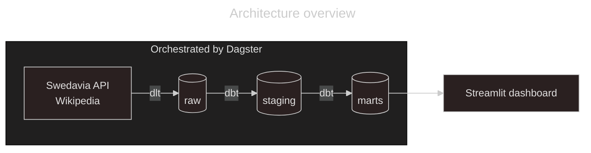

# Flight Punctuality Analytics


A modern data stack that measures flight punctuality at Sweden's ten Swedavia airports.
Arrivals and departures are loaded from the Swedavia FlightInfo API, modelled in Snowflake,
and served in a dashboard showing the share of delayed flights by airport, airline and day.

Built as the group lab in *Data Warehouse Lifecycle* (Data Engineering DE25, STI Stockholm).

**The scenario:** We are the data engineering team of a Swedish airport authority, asked for a
proof of concept that lets business stakeholders analyse delayed arrivals and departures.

## Architecture



All three layers are schemas in one Snowflake database, `flights_db`. Each step runs with its own role and can only touch its own layer:

| Step | Tool | Writes to | Snowflake role |
|---|---|---|---|
| Load | dlt | `swedavia_raw`, `wikipedia_raw` | `flights_loader` |
| Transform | dbt | `staging`, `marts` | `flights_transformer` | 
| Serve | Streamlit | reads `marts` only | `flights_reporter` | 
| Orchestrate | Dagster | runs loads and transforms as one job | - | 

The daily schedule is off by default and only switches on where `PIPELINE_CRON` is set:

| Where | `PIPELINE_CRON` | Schedule |
|---|---|---|
| Local - `uv run dagster dev` | not set | Stopped, runs are started by hand |
| Docker Compose | not set | Stopped, runs are started by hand |
| Azure - Johnny | `0 18 * * *` | Running, 18:00 Swedish time |
| Azure - Indira | `0 19 * * *` | Running, 19:00 |
| Azure - Aira | `0 20 * * *` | Running, 20:00 |
| Azure - Christoffer | `0 21 * * *` | Running, 21:00 |

Each Azure deploy sets its own time in `terraform/terraform.tfvars`. One hour apart, so two
runs never share dlt's temporary tables.


## Delay definition

The API has no "delayed" field, so delay is calculated from scheduled and actual time.
The rules are applied in dbt and are the same for arrivals and departures:

| Term | Definition |
|---|---|
| Delayed | Completed, and more than 15 minutes late (`delay_seconds > 900`) |
| Completed | Status `LAN` (landed) for arrivals, `ACT` (departed) for departures |
| Cancelled | Status `CAN`. Counted on its own, never as delayed |
| Removed | Status `DEL`. Filtered out in staging |
| Delayed share | Delayed ÷ completed |
| Date | The scheduled date in Swedish time |
| Airports | Swedavia's ten airports, the only ones the API covers |

15 minutes is the standard threshold for on-time performance in aviation.

## Quickstart

Requires [uv](https://docs.astral.sh/uv/), a Snowflake account set up with `snowflake_setup/`
and a [Swedavia API key](https://apideveloper.swedavia.se/).

```bash
git clone https://github.com/indiramahadiva/Flight-punctuality_4_DE25.git
cd Flight-punctuality_4_DE25
uv sync
cp .env.example .env                        # fill in your credentials
uv run dbt deps --project-dir dbt_project   # installs dbt packages

# Terminal 1 - pipeline -> http://localhost:3000, then "Materialize all"
uv run dagster dev

# Terminal 2 - dashboard -> http://localhost:8501
uv run --env-file .env streamlit run src/flight_punctuality/dashboard/app.py
```

With `.env` filled in, both can also run as containers: `docker compose up --build`.
To deploy both to your own Azure account: [Deploy to Azure](docs/deploy_to_azure.md).

## Documentation

- [Commands](docs/commands.md) - Every command, dev and prod
- [Run locally](docs/run_locally.md) - full setup, from Snowflake to dashboard
- [Run with Docker](docs/run_with_docker.md) - both containers with Docker Compose
- [Deploy to Azure](docs/deploy_to_azure.md) - one `terraform apply` per person
- [EDA findings](docs/eda_findings.md) - what the Swedavia data looks like
- [Data model](docs/ERD_dimensional_model.png) - the dimensional model ([dbdiagram source](docs/ERD_dimensional.dbml))

## Project structure

```text
Flight-punctuality_4_DE25/
├─ src/flight_punctuality/
│  ├─ ingestion/       dlt sources and pipelines (Swedavia, Wikipedia)
│  ├─ defs/            Dagster assets and schedule
│  └─ dashboard/       Streamlit app
├─ dbt_project/        staging and marts models, tests, seed
├─ snowflake_setup/    SQL for warehouse, database, roles and grants
├─ docker/             Dockerfiles for the pipeline and the dashboard
├─ terraform/          Azure deployment: registry, Container App, Web App
├─ docs/               guides, EDA findings, ERD
├─ notebooks/          EDA of the Swedavia data
├─ tests/              pytest for the dlt source
├─ sql/                ad hoc validation queries
├─ docker-compose.yml  runs both containers
└─ pyproject.toml      dependencies, grouped per container
```

## Data sources

- [Swedavia FlightInfo API](https://apideveloper.swedavia.se/) - arrivals and departures
- Wikipedia - [airline codes](https://en.wikipedia.org/wiki/List_of_airline_codes) and [international airports](https://en.wikipedia.org/wiki/List_of_international_airports_by_country)
- `dbt_project/seeds/swedavia_airports.csv` - the ten Swedavia airports

## Team

- **[Aira Franco](https://github.com/Akina-Aoki)** - Data Engineer
- **[Christoffer Carlsson](https://github.com/christocar)** - Data Engineer
- **[Johnny Hyytiäinen](https://github.com/JohnnyHyytiainen)** - Data Engineer
- **[Putu Indira Mahadiva Arysaputri](https://github.com/indiramahadiva)** - Data Engineer